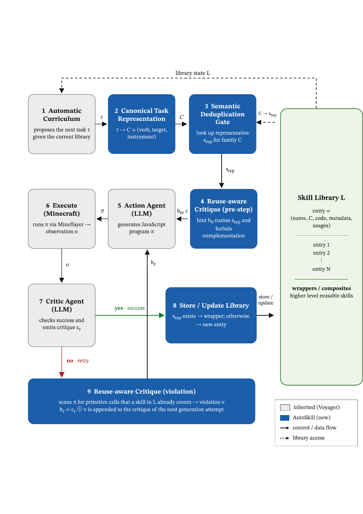
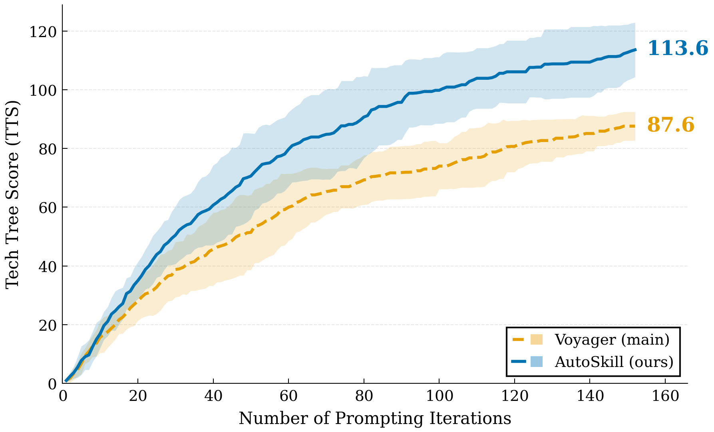
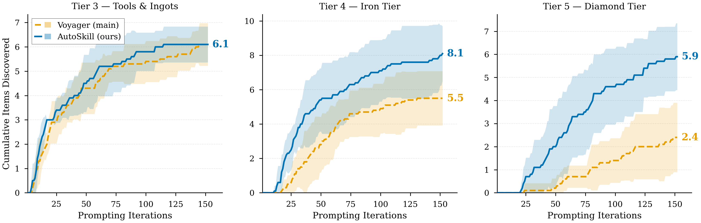
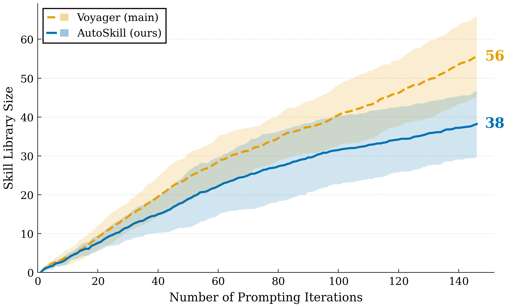
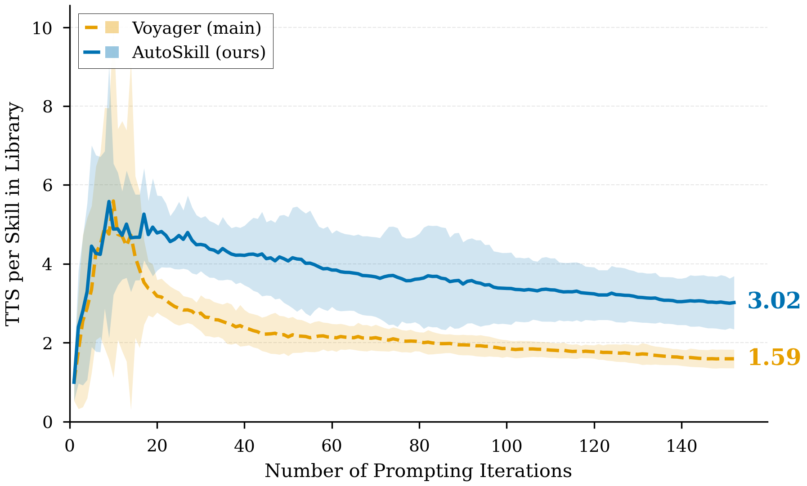

<div align="center">

# AutoSkill

### Semantic Deduplication and Reuse-Aware Skill Learning for Open-World LLM Agents

*Hyungjin Kim · Seungyub Han · Jungwoo Lee — Seoul National University*

**Under review, IEEE Access (2026)**

[](#installation)
[-green.svg)](#installation)
[](LICENSE)
[](https://github.com/MineDojo/Voyager)



</div>

---

**TL;DR** — Lifelong LLM agents such as Voyager keep re-writing skills they already have.
AutoSkill adds two drop-in mechanisms to the Voyager loop — a **canonical-signature
deduplication gate** and a **reuse-aware critique** — so the agent *calls* its library
instead of *re-implementing* it. Over **n = 10** independent 150-step Minecraft runs per
method, AutoSkill reaches **+29.7 % Tech-Tree Score** (113.6 vs. 87.6) with a
**31 % smaller** skill library; **every** AutoSkill run beats **every** Voyager run
(Mann–Whitney *U* = 100, *p* < 10⁻⁴).

## Results at a glance

| 150 steps, mean ± std, *n* = 10 / method | Distinct items | Tech-Tree Score | Library size | Items / skill |
|---|---:|---:|---:|---:|
| Voyager (GPT-4, vanilla) | 38.8 ± 1.7 | 87.6 ± 4.7 | 56.3 ± 10.0 | 0.69 |
| **AutoSkill (ours)** | **42.8 ± 3.9** | **113.6 ± 8.8** | **39.1 ± 7.8** | **1.09** |
| Δ | +10.3 % (*p* = 0.007) | **+29.7 %** (*p* < 10⁻⁴) | −31 % | +59 % |

<p align="center">


</p>

The gain is concentrated where it matters — deep in the tech tree.
AutoSkill acquires **+47 %** more iron-tier (T4) and **+146 %** more diamond-tier (T5) items,
and reaches the diamond tier roughly **2× earlier** (iteration 35 vs. 63).

<p align="center">

</p>

A compact library is a *more valuable* library: each stored AutoSkill skill accounts for
~1.9× the Tech-Tree Score of a Voyager skill.

<p align="center">


</p>

Every number above is reproducible from the bundled per-run results without a Minecraft server:

```bash
python analysis/summarize_results.py     # reads results/per_run_n10.csv
```

## What AutoSkill adds to Voyager

| Component | Where | What it does |
|---|---|---|
| **Canonical task signature** | `voyager/agents/skill_semantic.py` | Parses every task into a `(verb, target, instrument)` *family key* (`mine 5 copper ore` → `(mine, copper_ore, stone_pickaxe)`), so paraphrases and count-variants collapse to one family. |
| **Deduplication gate** | `voyager/agents/skill.py` | A candidate skill whose family key already exists is *merged* into the entry (or stored as a thin wrapper) instead of appended — the library stays 31 % smaller with no loss of coverage. |
| **Reuse-aware critique** | `voyager/agents/critic.py`, `voyager/prompts/action_template.txt` | *Before* code generation: injects the top-*k* retrieved skills as a "call these" hint. *After*: flags generations that re-implement an existing skill's behaviour without calling it (redefinition), feeding the violation back into the next iteration. |
| **Tech-Tree Score (TTS)** | `tech_tree_score.py` | Tier-weighted progress metric (6 tiers, derived from the crafting prerequisite graph) that separates *deeper* progress from *more* items. |

Everything else — curriculum, action agent, self-verification, Mineflayer bridge — is
inherited unchanged from [Voyager](https://github.com/MineDojo/Voyager).

The mechanism is not Minecraft-specific: applied offline to the tool-use benchmark
**ToolBench** (6,474 instructions), the same deduplication gate compacts the skill set by
**57 %** and raises the number of distinct tool signatures in top-5 retrieval from 3.1 to 5.0
(+63 %).

## Repository layout

```
voyager/                 Agent code (AutoSkill modifications marked in the table above)
learn.py                 Entry point: python learn.py -max 150
tech_tree_score.py       TTS metric and tier table
analysis/                Plot scripts for every figure + summarize_results.py
results/per_run_n10.csv  End-of-run metrics for all 20 runs (items, TTS, library size, per-tier items)
scripts/                 Exact orchestration used for the reported runs (fresh world per seed, fixed spawn)
docs/figs/               Figures as in the paper
skill_library/           Voyager's sample libraries (upstream)
```

## Installation

Prerequisites: Python ≥ 3.9, Node.js ≥ 16, Java 17, a Minecraft **1.19 Fabric** server, an OpenAI API key.

```bash
git clone https://github.com/gudwls909/autoskill-ieee.git && cd autoskill-ieee
pip install -e .
cd voyager/env/mineflayer && npm install && cd mineflayer-collectblock && npx tsc && cd .. && npm install && cd ../../..
```

Set up the Minecraft server exactly as in the Voyager
[installation guide](installation/minecraft_instance_install.md) (Fabric 1.19, `online-mode=false`,
RCON enabled). The reported runs use a **fresh world per seed** with a fixed spawn:

```
setworldspawn 64 65 0
gamerule spawnRadius 0
```

## Running

```bash
export OPENAI_API_KEY=sk-...        # never hard-code it; learn.py refuses to start without it
python learn.py -max 150 -mc-port 25565 -server-port 3000 -id my-run
```

Per-step metrics (`step_log.jsonl`: task, success, distinct items, TTS, library size, reuse) and the
skill library are written to `logs/run-<id>/`. `scripts/run_resub_seed.sh` shows the full
server-reset → spawn-fix → run sequence used for every seed in the paper.

To regenerate the figures from your own logs:

```bash
python analysis/plot_ci.py --metric tech_tree_score     # Fig. TTS curve
python analysis/plot_ci.py --metric distinct_items
python analysis/plot_tier_progression.py                # per-tier progression
python analysis/plot_dedup_efficiency.py                # library size
python analysis/plot_efficiency.py                      # TTS per stored skill
```

(Edit the `RUNS` dict in `analysis/_common.py` / each script to point at your run IDs.)

## Notes on the experimental protocol

* **n = 10 per method** = the 5 original instrumented runs plus 5 additional independent runs
  added for the revision. The additional AutoSkill runs include three robustness fixes to inherited
  Voyager plumbing that were found while scaling *n* (crafting-table acquisition in
  `craftItem.js`, a hard-coded chest loop that bypassed the curriculum filter, and the failed-task
  retry threshold in `curriculum.py`); the Voyager baseline is unmodified upstream code. Raw
  per-run values for all 20 runs are in `results/per_run_n10.csv`.
* GPT-4 for all agents, temperature 0, peaceful difficulty, 150 prompting iterations, one
  Minecraft world per run. Standard deviations are population (ddof = 0), matching the paper.
* Detailed library-quality analyses in the paper (composite rate, true-reuse rate, ablations) use
  the 5 instrumented runs, which log per-generation reuse events.

## Citation

```bibtex
@article{kim2026autoskill,
  title   = {AutoSkill: Semantic Deduplication and Reuse-Aware Skill Learning for Open-World LLM Agents},
  author  = {Kim, Hyungjin and Han, Seungyub and Lee, Jungwoo},
  journal = {IEEE Access (under review)},
  year    = {2026}
}
```

## Acknowledgements

Built on [MineDojo/Voyager](https://github.com/MineDojo/Voyager) (MIT). The tool-use
generalization experiment uses [ToolBench](https://github.com/OpenBMB/ToolBench).
