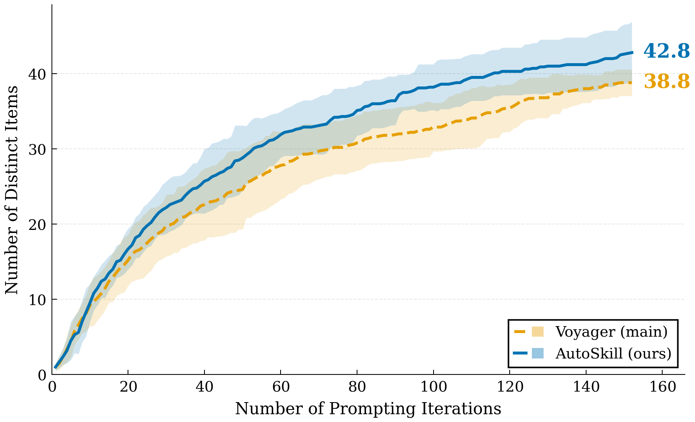

**TL;DR** — Lifelong LLM agents such as Voyager keep re-writing skills they already have.
AutoSkill changes three things in the Voyager loop: a **canonical-key deduplication gate**, a
**reuse-aware critique**, and a **composite-aware curriculum prompt**, so that the agent *calls*
its library instead of *re-implementing* it. Over **n = 10** independent 150-step Minecraft runs
per method, AutoSkill reaches **+29.7 % Tech-Tree Score** (113.6 vs. 87.6) with a **31 % smaller**
skill library against the original-code Voyager baseline. Every AutoSkill run beats every Voyager run
(Mann–Whitney *U* = 100, *p* < 10⁻⁴).

> **Status of the revision (round 2).** We are running Voyager on the *same* code as AutoSkill, with
> only the three components switched off (`-ablation voyager_infra`, n = 10 with GPT-5.4-mini, n = 5
> each with GPT-5.4 and Qwen2.5-Coder-14B). See [Baselines](#baselines-and-conditions) for why this
> matters. Those runs are not yet in this repository; this README will be updated with them.

## Results at a glance

| 150 steps, mean ± std, *n* = 10 / method | Distinct items | Tech-Tree Score | Library size | Items / skill |
|---|---:|---:|---:|---:|
| Voyager (original code) | 38.8 ± 1.7 | 87.6 ± 4.7 | 56.3 ± 10.0 | 0.69 |
| **AutoSkill (ours)** | **42.8 ± 3.9** | **113.6 ± 8.8** | **39.1 ± 7.8** | **1.09** |
| Δ | +10.3 % (*p* = 0.007) | **+29.7 %** (*p* < 10⁻⁴) | −31 % | +59 % |

<p align="center">


</p>

The gain is concentrated deep in the tech tree.
AutoSkill acquires **+47 %** more iron-tier (T4) and **+146 %** more diamond-tier (T5) items,
and first reaches the diamond tier at iteration 35.0 on average, versus 63.1 for Voyager.

<p align="center">

</p>

### Revision experiments (round 2)

| Condition (GPT-5.4-mini, n = 10) | TTS | Library | True reuse | Composite |
|---|---:|---:|---:|---:|
| Voyager (original code) | 87.6 ± 4.7 | 56.3 | 0.1 % | 0 % |
| Voyager + embedding dedup (τ = 0.95) | 77.4 ± 22.0 | 24.7 | 0.3 % | 0 % |
| AutoSkill w/o Dedup | 99.4 ± 22.3 (*p* = 0.052) | 54.6 | 35.9 % | 37.4 % |
| AutoSkill w/o Critique | 111.4 ± 16.3 (*p* = 0.21) | 36.0 | 2.8 % | 1.6 % |
| AutoSkill w/o Curriculum | 101.0 ± 15.5 (*p* = 0.023) | 37.5 | 26.6 % | 4.9 % |
| **AutoSkill** | **113.6 ± 8.8** | 39.1 | 34.6 % | 15.6 % |

*p*: one-sided Mann–Whitney test against full AutoSkill (uncorrected).

| Backbone (n = 5) | Voyager (original code) | AutoSkill | *p* |
|---|---:|---:|---:|
| GPT-5.4 (+ GPT-5.4-mini) | 103.2 ± 14.5 | 137.6 ± 7.5 | 0.004 |
| Qwen2.5-Coder-14B (local, 4-bit) | 7.4 ± 1.2 | 51.8 ± 2.3 | 0.006 |

## What AutoSkill changes in Voyager

| Component | Where | What it does |
|---|---|---|
| **Canonical task key** | `voyager/agents/skill_semantic.py` | Maps each task to a family key `primitive:target:*` (e.g. `Mine 5 copper ore` → `mineBlock:copper_ore:*`). A rule parses the task text; when it does not match, the key comes from the program's terminal primitive, or from an LLM (GPT-4o-mini) when the program calls other skills. The instrument field is a wildcard in all reported runs. |
| **Deduplication gate** | `voyager/agents/skill.py` | A successful program whose family key already has a representative is **discarded**; otherwise it is stored as the family's representative. No wrapper is generated. |
| **Reuse-aware critique** | `voyager/voyager.py`, `voyager/prompts/action_template.txt` | *Before* the first attempt: a hint naming the family representative (with a loop template when the count differs). *After each failed attempt*: a violation message when the program does not call the representative or calls a primitive that a stored skill covers. |
| **Composite-aware curriculum** | `voyager/prompts/curriculum.txt`, `voyager/agents/curriculum.py` | The curriculum prompt contains the TTS tier table, rules preferring goal-level tasks and library use, and the current inventory by tier and skill list. |
| **Tech-Tree Score (TTS)** | `tech_tree_score.py` | Sum of item tiers over the 150 hand-assigned items in `TECH_TREE` (6 tiers, guided by crafting prerequisites; unlisted items count as Tier 1). The map was fixed before the first reported run. |

The code shared by all AutoSkill conditions also differs from the original Voyager code
(control primitives, domain hints in the action and critic prompts, loop guards, response parsing);
see [Baselines](#baselines-and-conditions).

An offline label-level analysis on ToolBench is reported in the paper (Section VII-E). It measures how
often annotated (tool, api) sets repeat; it does **not** test AutoSkill outside Minecraft.

## Baselines and conditions

| Condition | Code | Curriculum | Dedup | Critique | `learn.py` flag / code |
|---|---|---|---|---|---|
| Voyager (original code) | upstream Voyager + environment-connection fixes | Voyager | – | – | `baselines/voyager_original/` |
| Voyager + embedding dedup | as above | Voyager | cosine ≥ 0.95 | – | `baselines/voyager_embedding_dedup.patch` |
| Voyager (shared code) *(running)* | AutoSkill code | Voyager | – | – | `-ablation voyager_infra` |
| AutoSkill w/o Curriculum | AutoSkill code | Voyager | ✓ | ✓ | `-ablation no_curriculum` |
| AutoSkill w/o Dedup | AutoSkill code | AutoSkill | – | ✓ | `-ablation no_dedup` |
| AutoSkill w/o Critique | AutoSkill code | AutoSkill | ✓ | – | `-ablation no_critique` |
| AutoSkill | AutoSkill code | AutoSkill | ✓ | ✓ | `-ablation none` |

* **Code revisions.** The five original runs per AutoSkill condition used the submission code
  (revision A). All runs added in the revision use the current code (revision B), which adds three
  fixes: `craftItem` obtains a crafting table when none is available, a forced chest-placement loop
  exits after repeated failures, and a task is rejected after three failures instead of five.
* In *w/o Critique* the action prompt keeps AutoSkill's mandatory-reuse wording (rule 2); only the
  hints and violation messages are removed. *Voyager (shared code)* uses Voyager's original rule 2.
* **Embedding model.** Retrieval uses OpenAI `text-embedding-ada-002` (the LangChain default; see
  `embedding_log.jsonl`). The `embedding_model` string in `meta.json` says `text-embedding-3-small`;
  that label is wrong.

## Repository layout

```
voyager/                    AutoSkill agent code
learn.py                    Entry point (model overrides via MODEL_MAIN / MODEL_SMALL / LLM_BASE_URL)
tech_tree_score.py          TTS metric and tier table
baselines/                  Original-code Voyager and the embedding-dedup patch
analysis/                   Plot scripts for every figure + summarize_results.py
analysis/revision2/         Scripts for the round-2 analyses (Tables 6, 8-10; Sections VI-F, VI-H, VI-K)
results/per_run_n10.csv     End-of-run metrics of the 20 main runs
results/run_logs_r2.tar.gz  Per-step logs of all 80 completed runs (step, skill, reuse, token, embedding logs)
scripts/                    Orchestration used for the reported runs (fresh world per seed, fixed spawn)
docs/figs/                  Figures as in the paper
```

### Reproducing the revision analyses (no Minecraft server needed)

```bash
tar xzf results/run_logs_r2.tar.gz          # creates logs/<run-id>/...
cd analysis/revision2
python r2_results.py           # ablations, embedding-dedup baseline, backbones (Tables 6, 9, 10)
python r32_tts_validation.py   # TTS vs. tool milestones, weight sensitivity (Table 8)
python r34_dedup_errors.py     # false / missed merges of the family-key gate
python r34_audit_sample.py     # random sample of unflagged decisions for manual audit
python r34_fm_impact.py        # later success of tasks lost to a false merge
python r31_calibrate_tau.py    # threshold calibration of the embedding-dedup baseline
python r31_ed_errors.py        # grouping errors of the embedding-dedup baseline
```

## Installation

Prerequisites: Python ≥ 3.9, Node.js ≥ 16, Java 17, a Minecraft **1.19 Fabric** server, an OpenAI API key.

```bash
git clone https://github.com/gudwls909/autoskill-ieee.git && cd autoskill-ieee
pip install -e .
cd voyager/env/mineflayer && npm install && cd mineflayer-collectblock && npx tsc && cd .. && npm install && cd ../../..
```

Set up the Minecraft server exactly as in the Voyager
[installation guide](installation/minecraft_instance_install.md) (Fabric 1.19, `online-mode=false`,
RCON enabled). The reported runs use a **fresh world per seed** with a fixed spawn:

```
setworldspawn 64 65 0
gamerule spawnRadius 0
```

## Running

```bash
export OPENAI_API_KEY=sk-...        # never hard-code it; learn.py refuses to start without it
python learn.py -max 150 -mc-port 25565 -server-port 3000 -id my-run
python learn.py -max 150 -ablation voyager_infra -id my-baseline   # Voyager on the shared code
```

Per-step metrics (`step_log.jsonl`: task, success, distinct items, TTS, library size, reuse) and the
skill library are written to `logs/run-<id>/`. `scripts/run_resub_seed.sh` shows the full
server-reset → spawn-fix → run sequence used for every seed in the paper.

To regenerate the figures from your own logs:

```bash
python analysis/plot_ci.py --metric tech_tree_score     # Fig. TTS curve
python analysis/plot_ci.py --metric distinct_items
python analysis/plot_tier_progression.py                # per-tier progression
python analysis/plot_dedup_efficiency.py                # library size
python analysis/plot_efficiency.py                      # TTS per stored skill
```

(Edit the `RUNS` dict in `analysis/_common.py` / each script to point at your run IDs.)

## Notes on the experimental protocol

* **n = 10 per condition** for the main comparison, the reuse analysis, and the ablations (see
  [Baselines](#baselines-and-conditions) for which runs use revision A or B); n = 5 per method for the
  GPT-5.4 and Qwen backbones.
* GPT-5.4-mini for the curriculum, action, and critic agents and GPT-5.4-nano for the skill manager;
  GPT-4o-mini for the canonicalization fallback (AutoSkill only); `text-embedding-ada-002` for retrieval.
  Peaceful difficulty, 150 prompting iterations, a fresh Minecraft world per run, fixed spawn.
  Standard deviations are population (ddof = 0), matching the paper.
* In the revision runs, a run that crashed or hung because of the Minecraft connection (server kick
  loops) was restarted from scratch under the same run id; all completed runs are reported.

## Citation

```bibtex
@article{kim2026autoskill,
  title   = {AutoSkill: Semantic Deduplication and Reuse-Aware Skill Learning for Open-World LLM Agents},
  author  = {Kim, Hyungjin and Han, Seungyub and Lee, Jungwoo},
  journal = {IEEE Access (under review)},
  year    = {2026}
}
```

## Acknowledgements

Built on [MineDojo/Voyager](https://github.com/MineDojo/Voyager) (MIT). The tool-use
generalization experiment uses [ToolBench](https://github.com/OpenBMB/ToolBench).
